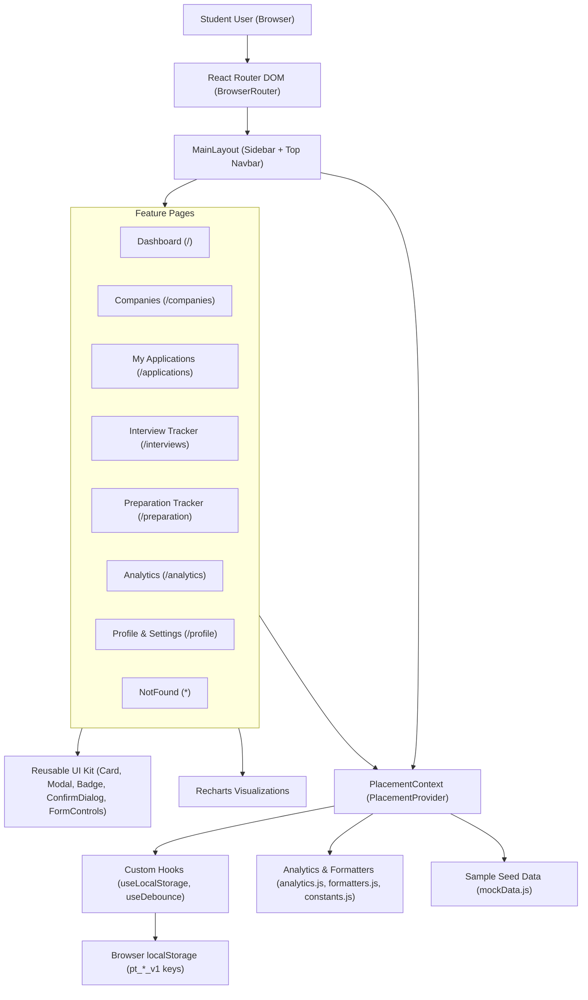
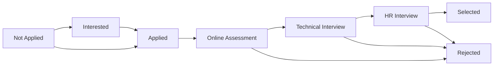
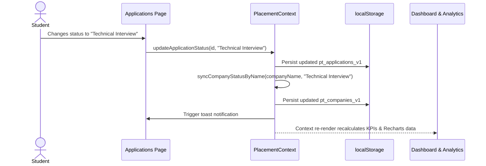

# System Design Document — PlaceTrack (Placement Tracker Web Application)

## 1. System Overview

**PlaceTrack** is a frontend-only, Single Page Application (SPA) designed to help college students organize and monitor their campus placement lifecycle. It centralizes company drives, job applications, interview schedules, preparation checklists, academic profiles, and placement funnel analytics into a single responsive interface.

### Architectural Goals
- **Zero-Backend Architecture:** Runs completely in the browser using mock seed datasets and `localStorage` persistence—requiring no server, database, or authentication service.
- **Reactive Single Source of Truth:** State changes (e.g., updating an application status or adding a company) propagate immediately across Dashboard KPIs, Charts, Companies, and Analytics views.
- **Modular Component Design:** Clean separation between presentation primitives (`components/ui/`), page containers (`pages/`), layout shell (`layouts/`), business utilities (`utils/`), custom hooks (`hooks/`), and global state (`context/`).
- **Responsive & Accessible UX:** Mobile-first grid layouts, collapsible navigation drawer, dark/light theme support, form validation, confirmation dialogs, and toast notifications.

---

## 2. High-Level System Architecture



---

## 3. Technology Stack

| Layer | Technology | Purpose |
| :--- | :--- | :--- |
| **UI Framework** | React 18 (`react`, `react-dom`) | Component rendering, hooks, and reactive UI updates |
| **Build Tool** | Vite | Fast HMR development server and optimized production bundling |
| **Styling** | Tailwind CSS | Utility-first styling, responsive breakpoints, and class-based dark mode |
| **Routing** | React Router DOM | Client-side navigation across 7 core views and 404 fallback |
| **Visualization** | Recharts | Responsive Area, Line, Bar, and Pie/Donut charts |
| **Icons** | Lucide React | Consistent vector iconography |
| **Persistence** | Browser `localStorage` | Client-side persistence across browser sessions |

---

## 4. Directory & Module Structure

```text
src/
├── components/ui/        # Reusable UI primitives (Button, Card, Modal, ConfirmDialog,
│                         # Badge, EmptyState, Skeleton, ToastContainer, FormControls,
│                         # CompanyAvatar, StatCard)
├── context/
│   └── PlacementContext.jsx  # Central state store, CRUD actions, theme, toasts, notifications
├── data/
│   └── mockData.js       # Sample seed records (10 companies, applications, interviews,
│                         # prep tasks, student profile, notifications)
├── hooks/
│   ├── useLocalStorage.js    # Generic JSON-serialized localStorage state hook
│   └── useDebounce.js        # Debounce utility hook
├── layouts/
│   └── MainLayout.jsx    # Persistent sidebar, mobile drawer, navbar, search, notifications
├── pages/                # Route-level feature pages (Dashboard, Companies, Applications,
│                         # Interviews, Preparation, Analytics, Profile, NotFound)
├── utils/
│   ├── analytics.js      # KPI aggregation, conversion rates, monthly & company trends
│   ├── constants.js      # Status enums, badge/chart color mappings, prep categories
│   └── formatters.js     # Date/time formatting, countdowns, URL checks, IDs, initials
├── App.jsx               # Route definitions and provider composition
├── index.css             # Tailwind directives and custom scrollbar rules
└── main.jsx              # React DOM root mount
```

---

## 5. Data Models & Client Storage Schema

All domain collections are hydrated from `src/data/mockData.js` on first load and persisted independently via `useLocalStorage` under versioned keys:

| Entity | `localStorage` Key | Key Fields |
| :--- | :--- | :--- |
| **Company** | `pt_companies_v1` | `id`, `name`, `initials`, `brandColor`, `industry`, `role`, `packageLPA`, `packageRange`, `location`, `deadline`, `eligibility`, `applicationStatus`, `openings`, `rounds[]`, `skillsRequired[]`, `description` |
| **Application** | `pt_applications_v1` | `id`, `companyId`, `companyName`, `position`, `appliedDate`, `packageLPA`, `status`, `notes` |
| **Interview** | `pt_interviews_v1` | `id`, `companyName`, `round`, `date`, `time`, `type` (`Online`/`Offline`), `meetingLink`, `notes`, `completed` |
| **PrepTask** | `pt_prep_tasks_v1` | `id`, `title`, `category`, `priority` (`High`/`Medium`/`Low`), `completed` |
| **Profile** | `pt_profile_v1` | `name`, `email`, `phone`, `collegeName`, `branch`, `graduationYear`, `cgpa`, `targetRole`, `skills[]`, `resumeFileName`, `resumeUpdatedAt`, `resumeSize` |
| **Notification** | `pt_notifications_v1` | `id`, `title`, `message`, `time`, `read`, `route` |
| **Theme** | `pt_theme_v1` | `'light'` \| `'dark'` |

### Application Status State Machine



---

## 6. State Synchronization & Data Flow

`PlacementContext` maintains cross-entity consistency on the client:
1. **Quick Apply Flow (`applyToCompany`)**: Clicking Quick Apply on a company creates a new application in `pt_applications_v1` (or updates an existing one) and synchronizes `applicationStatus` on the matching company record.
2. **Application Update/Delete (`updateApplicationStatus`, `updateApplication`, `deleteApplication`)**: Updating an application's status automatically updates the corresponding company's `applicationStatus`; deleting an application resets the linked company status to `'Not Applied'`.
3. **Real-Time Analytics Propagation**: `Dashboard` and `Analytics` derive all KPIs and chart series via `useMemo` over `companies`, `applications`, and `interviews`, ensuring instant UI recalculation without duplicate stored aggregates.



---

## 7. Routing Architecture

| Path | Component | Purpose |
| :--- | :--- | :--- |
| `/` | `Dashboard` | Default landing overview with KPIs, charts, upcoming interviews, and activity |
| `/companies` | `Companies` | Grid/table directory, search, industry/package filters, sorting, and detail modal |
| `/applications` | `Applications` | Full CRUD table, status filter pills, inline status updates, and delete confirmation |
| `/interviews` | `Interviews` | Upcoming/Completed/All tabs, Online/Offline badges, meeting links, and prep notes |
| `/preparation` | `Preparation` | Overall readiness bar, 6 category progress trackers, and task checklist CRUD |
| `/analytics` | `Analytics` | Conversion funnels, monthly trend lines, status donut chart, and company bar chart |
| `/profile` | `Profile` | Editable academic details, skill tag manager, frontend resume upload, and settings |
| `*` | `NotFound` | Custom 404 fallback page with navigation back to Dashboard |

---

## 8. Analytics & Metrics Computation (`src/utils/analytics.js`)

- **Shortlisted Applications**: Count of applications in `Online Assessment`, `Technical Interview`, `HR Interview`, or `Selected`.
- **Placement Success Rate**: `(Selected Offers / Total Applications) * 100` (rounded).
- **Application-to-Interview Rate**: `(Applications reaching Technical Interview, HR Interview, or Selected / Total Applications) * 100`.
- **Interview-to-Selection Rate**: `(Selected Offers / Applications reaching Interview stage) * 100`.
- **Monthly Trends**: Dynamically groups applications by `appliedDate` (`YYYY-MM`) across recent months, counting total applied, shortlisted, and selected offers per month.
- **Company-Wise Comparison**: Joins company CTC metadata with application counts for dual-axis bar visualization.

---

## 9. UI/UX, Validation & Reliability Design

- **Client-Side Validation**: Required field checks, numeric bounds (`packageLPA > 0`, `0 <= CGPA <= 10`), 4-digit graduation year check, HTTP/HTTPS URL validation for meeting links, and file extension checks (`.pdf`, `.doc`, `.docx`) on resume upload.
- **Destructive Action Safety**: Deleting applications, interviews, or prep tasks, as well as resetting demo data, triggers `ConfirmDialog` before mutating state.
- **Feedback & States**:
  - `ToastContainer` renders timed auto-dismissing notifications (`3.6s`) for CRUD actions.
  - `EmptyState` renders actionable prompts when filters return zero items.
  - `DashboardSkeleton` provides initial mount shimmer feedback.
- **Theme Persistence**: `PlacementContext` toggles the `dark` class on `document.documentElement` and persists user preference in `pt_theme_v1`.

---

## 10. Constraints & Future Backend Migration Path

- **Current Constraints**:
  - Data is scoped to a single browser profile (`localStorage`); clearing site data resets records to `mockData.js` defaults (or users can trigger **Reset Sample Data** manually).
  - Resume upload stores file metadata (`name`, `size`, `updatedAt`) rather than binary blobs to respect `localStorage` quota limits (~5 MB).
- **Future Backend Extension**:
  - Because all CRUD operations are encapsulated inside `PlacementContext` callbacks (`addApplication`, `updateApplication`, `deleteApplication`, etc.), replacing `useLocalStorage` with REST/GraphQL API calls and JWT authentication requires changes only inside `src/context/PlacementContext.jsx` without modifying page or UI components.

